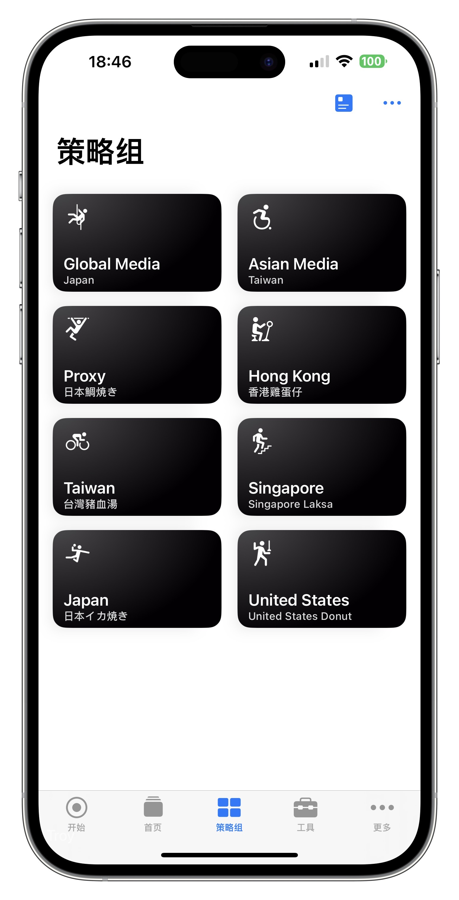

**English** | [简体中文](README.zh-CN.md)

# Surge configuration

**Maintenance paused.** This personal example is retained for reference; compatibility and remote resources are not guaranteed.

[View the file](Surge.conf) · [Raw download](https://raw.githubusercontent.com/Trovoy/Troy/main/Surge%20for%20myself/Surge.conf) · [Repository guide](../README.md)

Inspect the file, back up your existing settings and replace personal policy/subscription values before importing it through Surge. Validate syntax in your client version first.

No proxy subscription, server or client license is included. Refer to the root README for the original use notice, upstream credits and archived ruleset status.

