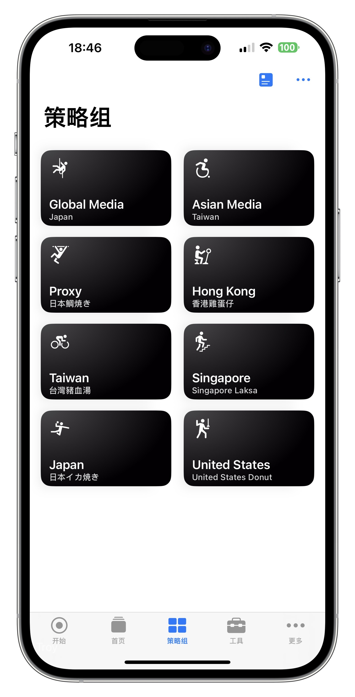

[English](README.md) | **简体中文**

# Surge 配置

**暂停维护。** 自用示例仅供参考，不保证兼容当前版本或远程资源可用。

[查看文件](Surge.conf) · [原始下载地址](https://raw.githubusercontent.com/Trovoy/Troy/main/Surge%20for%20myself/Surge.conf) · [仓库说明](../README.zh-CN.md)

导入前先检查文件并备份现有配置，替换自己的策略组和订阅信息，再使用 Surge 的导入功能，并校验当前版本语法。

不提供代理订阅、服务器或客户端许可证。原有使用声明、上游鸣谢和规则库归档状态见仓库根目录说明。

